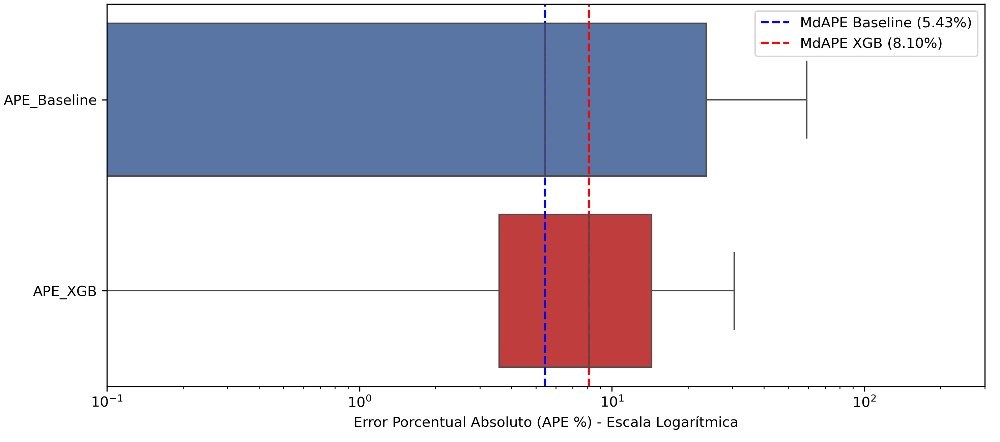
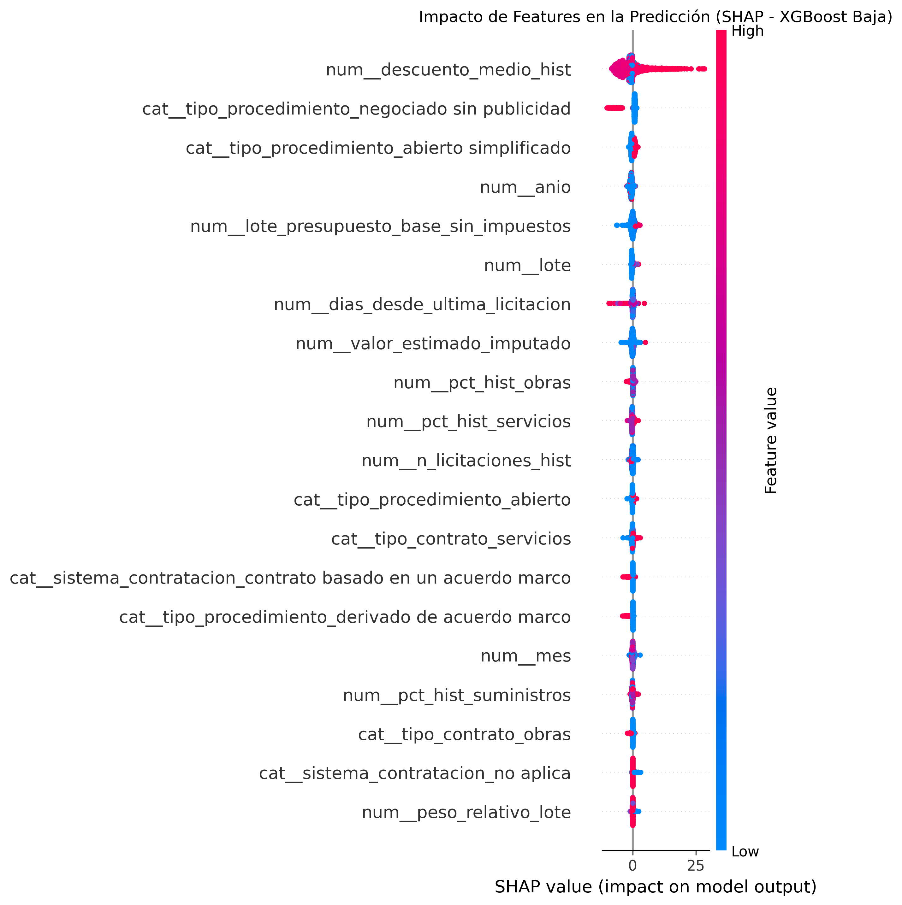
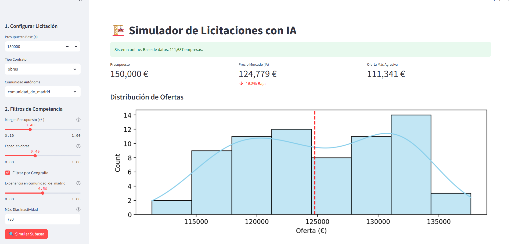
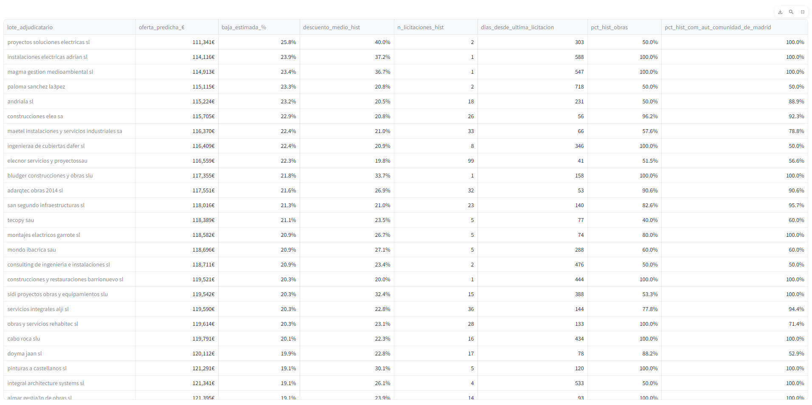

# 🏛️ Public Procurement ML: Auction Simulator & Tender Bid Prediction

[](https://github.com/PauMingot/Public-Procurement-ML/actions/workflows/ci.yml)
[](https://www.python.org/)
[](https://docs.pytest.org/)
[](https://opensource.org/licenses/MIT)
[](https://github.com/psf/black)
[](https://scikit-learn.org/)
[](https://streamlit.io/)

An end-to-end Machine Learning system and interactive auction simulator for predicting award prices and competitive bid discounts in **Spanish Public Procurement** (*Plataforma de Contratación del Sector Público - PLACE*). 

Developed as an applied mathematical and predictive analytics project (**Bachelor's Thesis in Mathematics**, *Grado en Matemáticas*, Faculty of Sciences).

---

## 📌 Business & Economic Context

Public procurement in Spain represents approximately **10% to 15% of national GDP**, mobilizing tens of billions of euros each year across infrastructure, healthcare, IT, and municipal services. 

In competitive public auctions:
- **Public Administrations** need objective statistical benchmarks to establish realistic tender budgets and detect abnormal or reckless discounts (*bajas temerarias*).
- **Private Contractors & Bidders** face an asymmetric game: submitting a bid that is too high guarantees losing the tender, while submitting a bid that is too low erodes operational margins or leads to execution deficits.

This project uses over **500,000 official procurement records (2018–2024)** from the official Spanish open data platform (PLACE) to model bidding behavior, predict winning award prices, and simulate sealed-bid auction dynamics.

---

## 📐 Mathematical Formulation: Why R² is Misleading in Public Tenders

A frequent flaw in public procurement data science is framing the problem as a naive regression of award amount in euros ($\hat{y} \approx y$). 

Because public contract budgets span **six orders of magnitude** (from 100 € municipal contracts to 50M € hospital infrastructures), contract budget naturally correlates with award amount. A trivial baseline predicting simply $y = \text{Budget}$ achieves an artificial $R^2 \approx 0.89$. In literature and junior portfolios, claiming an $R^2 = 0.98$ on raw euro amounts is a classic **vanity metric** that obscures massive relative errors on small and medium contracts.

To solve this, this research explores and contrasts two mathematical formulations:

### Formulation A: Absolute Award in Log-Space

$$\log(1 + y) = f(X) + \varepsilon \implies \hat{y} = \exp(\hat{z}) - 1$$

Stabilizes the variance across contract sizes, but remains vulnerable to scale distortion.

### Formulation B: Relative Bid Discount Percentage (% de baja)

$$\text{Discount (\%)} = \frac{\text{Budget} - \text{Award}}{\text{Budget}} \times 100$$

Predicting the discount percentage directly normalizes contract magnitude. A 10% discount on a 10,000 € contract is mathematically treated with the same relative precision as a 10% discount on a 1,000,000 € contract. Predictions are then mapped back to euro award amounts for direct business utility:

$$\text{Award}_{\text{pred}} = \text{Budget} \times \left(1 - \frac{\text{Discount}_{\text{pred}}}{100}\right)$$

### Evaluation Metric: MdAPE

Because procurement residuals have heavy-tailed, non-Gaussian distributions, Mean Absolute Error (MAE) and Root Mean Squared Error (RMSE) are disproportionately skewed by multi-million euro contracts. We adopt the **Median Absolute Percentage Error (MdAPE)** as the primary robust evaluation metric:

$$\text{MdAPE} = \text{median}\left( \left| \frac{y_i - \hat{y}_i}{y_i} \right| \right) \times 100$$

---

## 🏆 Empirical Benchmark & Results

All models were evaluated on a strictly segregated holdout test set. All predictions were mapped back to **real euro amounts** to guarantee an *apples-to-apples* benchmark:

| Model Architecture | Target Formulation | MAE (€) | MdAPE (%) | Test R² | Key Observations |
|:---|:---|:---:|:---:|:---:|:---|
| **Null Baseline** | Award = Base Budget | 83,717 € | 5.43% | 0.8912 | Reference baseline (assumes 0% discount) |
| **Regularized Linear (Ridge / Lasso)** | Award Amount (Log) | 60,928 € | 8.11% | 0.9015 | L1/L2 penalized parametric benchmark |
| **CART Decision Tree** | Award Amount (Log) | 67,515 € | 7.61% | 0.8841 | Single tree with cost-complexity pruning |
| **Random Forest Regressor** | Award Amount (Log) | 52,267 € | 9.12% | 0.9108 | 300 estimators, non-linear ensemble |
| **XGBoost Regressor (Winner)** | **% Bid Discount** | **44,427 €** | **8.10%** | **0.9264** | **Lowest MAE (cut error by 47% vs baseline)** |
| **TabM (Tabular Deep Learning)** | % Bid Discount | 47,076 € | 6.07% | 0.1281 | Multi-head tabular neural net; unstable R² |

> **Key Finding**: Gradient Boosted Decision Trees (**XGBoost**) modeling the relative discount percentage achieved the best overall performance, reducing the average monetary error from **83,717 € to 44,427 €** while offering full interpretability via TreeSHAP.

<div align="center">
  
  <p><em>Figure 1: Absolute Percentage Error (APE) distribution comparing baseline vs. winning XGBoost model.</em></p>
</div>

---

## 🔍 Model Explainability & Key Drivers (SHAP)

Understanding *why* a contractor or model bids at a certain price is critical for regulatory audits and company pricing committees. We implemented **TreeSHAP** to compute exact Shapley values on the winning model:

<div align="center">
  
  <p><em>Figure 2: SHAP summary plot for XGBoost predicting percentage bid discount.</em></p>
</div>

### Dominant Predictive Signals:
1. **Historical Contractor Aggressiveness (`descuento_medio_hist`)**: The primary driver of future discounts is the historical pricing strategy of the competing firm. Contractors have entrenched bidding habits.
2. **Contract Base Budget (`lote_presupuesto_base_sin_impuestos`)**: Larger contracts exhibit higher discounts due to economies of scale and heightened competition.
3. **Contract Type Specialization (`pct_hist_servicios`, `pct_hist_obras`)**: Public service tenders consistently attract different discount distributions than infrastructure or supply contracts.
4. **Contracting Authority Clustering (`organo_cluster_label`)**: Public entities (e.g., municipal councils vs. regional health ministries) have distinct payment terms and reputation, directly influencing bidder aggression.

---

## 🏛️ Interactive Auction Simulator (Streamlit App)

To operationalize the mathematical models into a real decision-support tool, we developed a production-ready **Streamlit web application**.

### Features:
- **Tender Parameterization**: Input contract base budget, type, contracting authority, and autonomous community.
- **Competitor Filtering Engine**: Automatically filters candidate contractors from a database of historical contractor profiles based on budget scale match, regional experience, and contract type specialization.
- **Simulated Sealed-Bid Auction**: Simulates the bids of all identified rivals using the fitted ML pipeline and produces a ranked leaderboard of predicted bids and award estimates.

<div align="center">
  
  <p><em>Figure 3: Auction Simulator configuration interface with competitor filtering controls.</em></p>
</div>

<div align="center">
  
  <p><em>Figure 4: Auction Simulator leaderboard showing predicted competitor bids in euros and discount percentages.</em></p>
</div>

---

## 🛡️ Data Leakage Prevention & Methodological Rigor

In procurement datasets, post-award information is frequently recorded in the same tables as initial tender requirements. Training on these introduces **catastrophic data leakage**:

- **Strict Elimination of Ex-Post Variables**: Columns such as `lote_numero_ofertas_recibidas` (number of received bids), `lote_precio_oferta_mas_baja` (lowest bid price), `lote_precio_oferta_mas_alta`, `es_sobrecoste` (cost overrun), and `duracion_proceso_dias` are strictly suppressed prior to model ingestion.
- **Economic Feasibility Boundaries**:
  - Filter out non-awarded or cancelled tenders (`es_exito == 1`).
  - Enforce award bound: Award must not exceed budget (`Award ≤ Budget`).
  - Exclude unit-price framework agreements where estimated value exceeds budget by more than 10× (`Estimated Value > 10 × Budget`).
  - Exclude symbolic bids (`Award < 2.00 €`).
- **One-Hot Dummy Aggregation**: Feature importance routines re-aggregate dummy variables back to parent categorical variables to prevent splitting bias.

---

## 🧪 Testing & Continuous Integration (CI/CD)

The repository includes an automated testing suite using `pytest` and runs continuous integration via **GitHub Actions** across Python 3.10, 3.11, and 3.12:

```bash
# Run unit test suite
pytest tests/ -v
```

```
tests/test_data_cleaning.py::test_clean_dataframe_amount_filters PASSED
tests/test_data_cleaning.py::test_clean_dataframe_bid_pct_computation PASSED
tests/test_data_cleaning.py::test_drop_leakage_columns PASSED
tests/test_metrics.py::test_mdape_perfect_prediction PASSED
tests/test_metrics.py::test_mdape_known_percentage PASSED
tests/test_metrics.py::test_mdape_zero_array PASSED
tests/test_metrics.py::test_evaluate_in_euros_output_structure PASSED
tests/test_metrics.py::test_evaluate_bid_in_euros PASSED
tests/test_preprocessing.py::test_build_preprocessor_fit_transform PASSED
tests/test_preprocessing.py::test_preprocessor_handle_unknown_category PASSED

============================= 10 passed in 2.2s ==============================
```

---

## 🏗️ Repository Structure

```
Public-Procurement-ML/
├── .github/
│   └── workflows/ci.yml            # Automated CI/CD pipeline (Python 3.10, 3.11, 3.12)
├── .gitignore                      # Excludes raw large datasets, models & caches
├── requirements.txt                # Pinned dependencies for full reproducibility
├── config.py                       # Single source of truth (paths, schemas, hyperparameters)
│
├── data/                           # Datasets directory
│   ├── sample_tenders.parquet      # 500-row representative dataset for instant execution
│   └── sample_profiles.parquet     # 250-row contractor profile database for simulator demo
│
├── docs/                           # Documentation and visual figures
│   └── images/                     # Real figures extracted from thesis & simulator
│       ├── boxplot_error_xgb.png
│       ├── shap_xgb_baja.png
│       ├── streamlit_app_demo.png
│       └── streamlit_app_results.png
│
├── src/                            # Modular production library
│   ├── __init__.py
│   ├── data_cleaning.py            # Business logic filters & data leakage suppression
│   ├── metrics.py                  # MdAPE, euro-scale conversions & evaluation routines
│   ├── preprocessing.py            # Sklearn ColumnTransformer builder
│   ├── feature_importance.py       # One-hot dummy parent feature aggregation
│   └── visualization.py            # Automated, memory-safe plotting routines
│
├── eda/                            # Exploratory Data Analysis
│   ├── eda_amount.py               # Award amount distributions & budget correlation
│   ├── eda_bid_discount.py         # Bid discount percentage distributions
│   └── eda_companies.py            # Contractor market concentration & bidding frequency
│
├── models/                         # Machine learning model suites
│   ├── baselines/                  # Naive baselines & CART decision trees
│   │   ├── baseline_amount.py
│   │   └── baseline_bid.py
│   ├── linear/                     # Regularized linear models (Ridge, Lasso)
│   │   ├── regression_amount.py
│   │   └── regression_bid.py
│   ├── random_forest/              # Random Forest training & hyperparameter tuning
│   │   ├── rf_amount.py
│   │   ├── rf_bid.py
│   │   ├── tuning_rf_amount.py
│   │   └── tuning_rf_bid.py
│   └── xgboost/                    # Gradient Boosting training & early stopping
│       ├── xgb_amount.py
│       ├── xgb_bid.py
│       ├── tuning_xgb_amount.py
│       └── tuning_xgb_bid.py
│
├── app/                            # Interactive procurement simulator
│   └── streamlit_app.py            # Streamlit dashboard for tender simulation
│
├── scripts/                        # Data processing & ETL utilities
│   ├── build_company_profiles.py   # Extracts contractor track records from raw PLACE data
│   └── create_sample_data.py       # Generates sample datasets for zero-setup execution
│
└── tests/                          # Automated test suite
    ├── test_data_cleaning.py       # Tests for leakage suppression & business filters
    ├── test_metrics.py             # Tests for MdAPE and euro-scale conversions
    └── test_preprocessing.py       # Tests for ColumnTransformer pipelines
```

---

## 🚀 Quickstart: Run in 60 Seconds

The repository includes bundled **sample datasets** (`data/sample_tenders.parquet` and `data/sample_profiles.parquet`), allowing anyone to clone and execute the entire project without needing the 850MB raw historical dataset.

### 1. Clone & Set Up Environment

```bash
git clone https://github.com/PauMingot/Public-Procurement-ML.git
cd Public-Procurement-ML

# Create virtual environment
python -m venv .venv
source .venv/bin/activate  # On Windows: .venv\Scripts\activate

# Install dependencies
pip install -r requirements.txt
```

### 2. Run the Test Suite

```bash
pytest tests/ -v
```

### 3. Train the Winning XGBoost Model

```bash
python models/xgboost/xgb_bid.py
```
*(Automatically falls back to `data/sample_tenders.parquet` if full dataset is not present; completes in ~5 seconds and outputs model artifact and SHAP plot).*

### 4. Launch the Streamlit Auction Simulator

```bash
streamlit run app/streamlit_app.py
```

---

## 👤 Author & Academic Context

**Pau Mingot Lapiedra**  
- **Education**: Bachelor's Degree in Mathematics (*Grado en Matemáticas*), Faculty of Sciences.
- **Academic Year**: 2025–2026.
- **Specialization**: Data Science, Applied Statistics, Machine Learning & Quantitative Analytics.
- **GitHub**: [@PauMingot](https://github.com/PauMingot)  
- **LinkedIn**: [Pau Mingot](https://www.linkedin.com/in/pau-mingot/)
